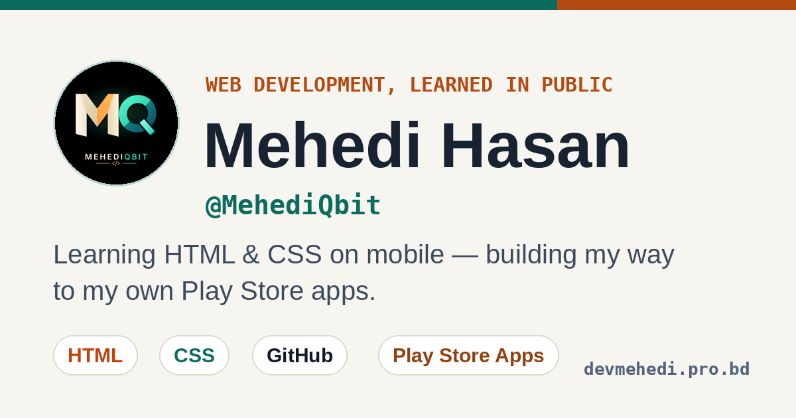

# Mehedi Hasan — Portfolio Website

> **Mehedi Hasan** · Handle: **@MehediQbit** · Live: **[devmehedi.pro.bd](https://devmehedi.pro.bd/)** · Repo: **MehediQbit.github.io**

Personal portfolio of Mehedi Hasan — an Accounting (Honours) student from Bangladesh learning web development on a mobile phone, building his first projects, and working towards publishing his own apps on the Play Store.



## Features

- **Bilingual, fully separated** — a বাংলা | EN toggle in the top bar switches *every* visible string. No mixed-language sentences. The choice is saved (`localStorage` key `mq-lang`); first visit follows the browser language. All strings live in `config.js` (`I18N` + per-item `en`/`bn` fields).
- **Stylish fonts** — English: Space Grotesk (headings) + Inter (body). Bengali: Hind Siliguri (body/UI) + Noto Serif Bengali (headings). Code: JetBrains Mono.
- **Unique design** — light, eye-friendly palette: warm paper background (`#f7f5f0`), white cards, near-black text (`#182230`), with the MQ logo colours darkened for readability — dark teal `#0b6b5e` and burnt orange `#b44a12`. Every body text is at least 4.5:1 contrast, base font 17px / 1.75 line-height, so nothing strains the eyes. Still unique: vertical `@MehediQbit` handle rail, oversized outlined MQ watermark, CSS MQ monogram mark, scrolling marquee strip, asymmetric section offsets and offset-corner cards. Not a generic template.
- **Logo use** — the supplied MQ logo (`logo.png`) is the brand logo only: top-bar brand mark, favicon / apple-touch icon, contact & footer mark, and the OG image. It is **not** used as a personal photo or profile picture anywhere; there is no portrait element on the site.
- **Fully responsive** — mobile-first, phone / tablet / desktop.
- **SEO-ready** — meta description, canonical, Open Graph + Twitter cards, JSON-LD Person schema (with the real WhatsApp Channel link), `sitemap.xml`, `robots.txt`.
- **Easy to update** — all text and links live in **one file: `config.js`**.
- **Accessible** — semantic HTML, skip link, focus states, `prefers-reduced-motion`, zoom enabled.

## Project Structure

```text
.
├── index.html    # Page structure + SEO / OG / schema
├── style.css     # All styling
├── config.js     # ★ EDIT THIS — profile, bilingual strings, skills, roadmap, projects, socials
├── script.js     # Language toggle + rendering, typewriter, tilt, copy-email
├── logo.png      # MQ brand logo (also favicon / touch icon / OG art)
├── favicon.png   # 64×64 logo favicon
├── favicon.svg   # Legacy MH monogram (kept for repo compatibility)
├── og-image.png  # 1200×630 social share image
├── robots.txt
├── sitemap.xml
├── CNAME         # Custom domain: devmehedi.pro.bd
├── .gitignore
└── README.md
```

Matches the public **MehediQbit / MehediQbit.github.io** repository layout, with `config.js`, `logo.png` and the SEO assets added.

## How to Update the Site

> These instructions live **only here and in code comments** — never on the public site.

1. Open **`config.js`**.
2. Change only text inside `"..."`. Keep quotes and commas.
   - Every visible string needs **both** an `en` and a `bn` version — do not mix languages inside one string.
   - Skill status: `"now"` / `"next"` · Project status: `"live"` / `"progress"` / `"next"`
3. Commit / upload to GitHub — GitHub Pages updates the live site automatically.
4. Colours / layout: edit variables at the top of `style.css` only.

**About admin panels:** GitHub Pages serves static files only — there is no server and no database, so a login-based admin panel cannot run there. That is a platform limit, not a missing feature. `config.js` is the practical substitute: one file, edited in code, committed to GitHub. If a real admin panel is ever needed, the site would need a different host (a CMS or a backend host) — the front-end files here would still work as the theme/content source.

## Deploy (GitHub Pages)

1. Upload all files in this folder to the **MehediQbit.github.io** repository (keep file names, including `.gitignore`).
2. Repo: **Settings → Pages** → Source: `main` branch, `/ (root)`.
3. The `CNAME` file points the site to `devmehedi.pro.bd`.
4. Submit `sitemap.xml` in Google Search Console after going live.

## About the Names & Domain (internal note — not shown on the site)

- **Mehedi Hasan** — real name; the site's main name.
- **@MehediQbit** — username/handle on all platforms (chosen because “Mehedi Hasan” was taken as a username).
- **devmehedi.pro.bd** — only the site's address: a community subdomain under **pro.bd**, provided by a developer community so members can host portfolio sites. It is not a brand name.
- A separate brand name will be created later; work comes first.

## Social Links

- GitHub: https://github.com/MehediQbit
- Facebook: https://www.facebook.com/MehediQbit
- Instagram: https://www.instagram.com/MehediQbit
- Threads: https://www.threads.net/@MehediQbit
- X: https://x.com/MehediQbit
- YouTube: https://www.youtube.com/@MehediQbit
- Telegram: https://t.me/MehediQbit
- WhatsApp Channel: https://whatsapp.com/channel/0029Vb95B8R2ER6h6YSxii3x
- Email: hello@devmehedi.pro.bd

## Built With

HTML5 · CSS3 · Vanilla JavaScript · Google Fonts · Font Awesome · GitHub Pages

---

© 2026 Mehedi Hasan (@MehediQbit)
